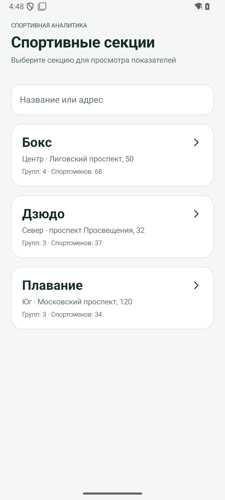
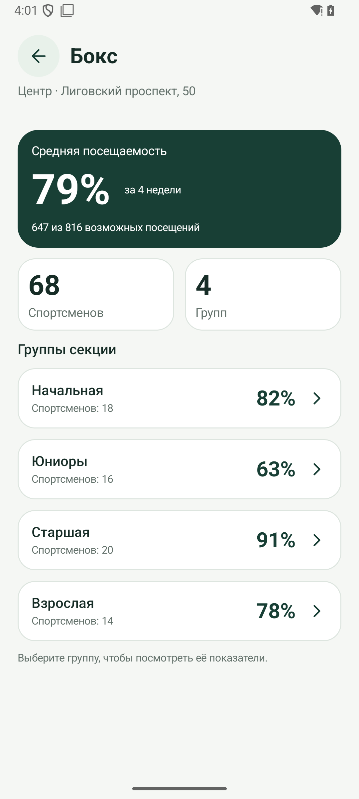
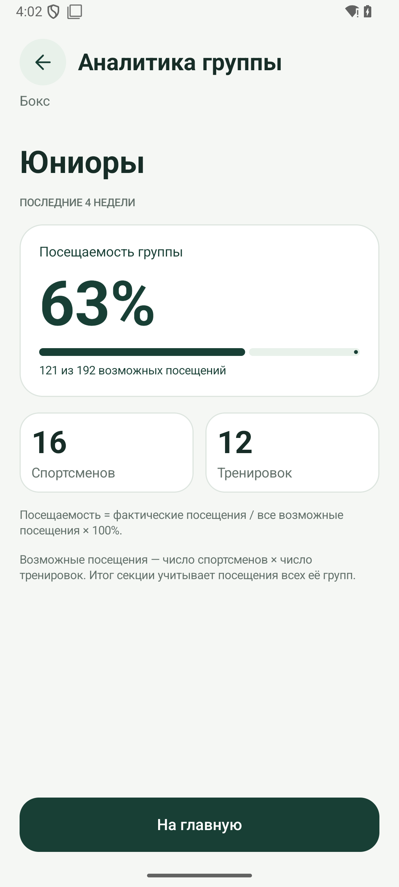

# Аналитика спортивных секций — задание 3

Учебное Android-приложение для руководителя спортивной организации. Три экрана позволяют выбрать секцию, посмотреть её показатели и группы, затем открыть сводку выбранной группы. В демонстрационной версии используются секции одной условной организации; вход в аккаунт не требуется.

Стек: Kotlin, Jetpack Compose, Navigation Compose, ViewModel, StateFlow и Hilt. Макеты: [Figma](https://www.figma.com/design/WRwDHpiFmMmTJoSEph7znt).

## 1. Сборка и запуск

Текущая конфигурация: JDK 25, Gradle Wrapper 9.6.0, Android Gradle Plugin 9.4.1, `compileSdk` / `targetSdk` 37, `minSdk` 29. Установите Android SDK Platform 37 и инструменты сборки через SDK Manager. Для Gradle выберите JDK 25 в Android Studio; при запуске из терминала укажите эту JDK в `JAVA_HOME`.

Откройте корень проекта в Android Studio, дождитесь синхронизации Gradle и запустите конфигурацию `app` на устройстве или эмуляторе с Android 10 / API 29 либо новее. Локальный путь к SDK хранится в `local.properties` и не передаётся в Git.

Сборка из корня проекта в Windows PowerShell:

```powershell
.\gradlew.bat :app:assembleDebug
```

Linux / macOS:

```bash
./gradlew :app:assembleDebug
```

APK появится в `app/build/outputs/apk/debug/app-debug.apk`.

Проверка кода Android Lint:

```powershell
.\gradlew.bat :app:lintDebug
```

В Linux / macOS используйте `./gradlew` с тем же именем задачи.

## 2. Демо-данные и пустые состояния

Основной набор — `app/src/main/assets/sports_sections.json`. Названия и адреса являются демонстрационными данными, а не сведениями о реальных организациях.

| Секция | Локация | Группы | Спортсмены | Фактические / возможные посещения | Посещаемость |
|---|---|---:|---:|---:|---:|
| Бокс | Центр · Лиговский проспект, 50 | 4 | 68 | 647 / 816 | 79% |
| Дзюдо | Север · проспект Просвещения, 32 | 3 | 37 | 369 / 444 | 83% |
| Плавание | Юг · Московский проспект, 120 | 3 | 34 | 252 / 312 | 81% |

В боксе есть группы «Начальная», «Юниоры», «Старшая» и «Взрослая». У «Юниоров» 16 спортсменов, 12 тренировок и 121 посещение из 192 возможных: 63%. В плавании у группы «Оздоровительная» ещё нет проведённых тренировок — вместо процента показывается тире.

Источник данных скрыт за интерфейсом `SportsRepository`. Реализация `AssetSportsRepository` читает JSON из `assets`; Hilt связывает интерфейс с реализацией. UI не читает файлы и не содержит демонстрационные списки.

Бизнес-расчёт вынесен в обычную Kotlin-функцию `calculateAttendance` без Android и Compose:

```text
возможные посещения группы = число спортсменов × число тренировок
посещаемость = фактические посещения / возможные посещения × 100%
```

Процент округляется до целого. Для секции сначала суммируются фактические и возможные посещения всех её групп, затем вычисляется общий процент. Это взвешенный показатель, а не среднее процентов групп. При нулевом знаменателе показатель отсутствует: в UI отображается «—», деления на ноль нет.

Пустые состояния можно открыть двумя способами:

- На первом экране введите в поиск название, которого нет, например `Несуществующая секция`. Появится сообщение об отсутствии результатов и действие очистки поиска.
- Пересоберите приложение с отдельным демонстрационным набором. `empty_sections.json` содержит пустой список секций; `empty_groups.json` — одну секцию без групп. После установки полученного APK второй вариант открывается через карточку «Бокс».

```powershell
.\gradlew.bat :app:assembleDebug -PdemoDataFile=empty_sections.json
.\gradlew.bat :app:assembleDebug -PdemoDataFile=empty_groups.json
```

Чтобы вернуться к основному набору, соберите приложение без параметра `demoDataFile` либо передайте `-PdemoDataFile=sports_sections.json`. В Android Studio установите и запустите APK нужной сборки; уже установленная версия не меняется только от выполнения `assembleDebug`.

## 3. Маршруты

| `route` | Аргументы | Экран |
|---|---|---|
| `sections` | Нет | Список секций и поиск |
| `section/{sectionId}` | `sectionId: String` | Показатели выбранной секции и список её групп |
| `section/{sectionId}/group/{groupId}` | `sectionId: String`, `groupId: String` | Сводка выбранной группы |

Маршруты описаны строками и зарегистрированы в `NavHost`. Аргументы объявлены через `navArgument`. Между экранами передаются идентификаторы, а данные загружаются через репозиторий.

Основной сценарий: найти секцию «Бокс» с локацией «Центр · Лиговский проспект, 50» → открыть «Юниоры» → увидеть 63%. Системная кнопка «Назад» возвращает к группам, повторное нажатие — к списку секций. Кнопка «На главную» доступна прямо на экране аналитики группы и удаляет промежуточные экраны из стека. Поиск хранится во ViewModel; идентификаторы выбранной секции и группы сохраняются в аргументах навигации и `SavedStateHandle` при повороте устройства.

## 4. Что реализовано и что отложено

В этой версии реализованы три экрана, переходы с аргументами, состояние во ViewModel через StateFlow, чтение состояния через `collectAsStateWithLifecycle()`, внедрение зависимостей Hilt, локальный репозиторий, расчёт посещаемости, поиск, пустые состояния и обработка ошибок загрузки или неизвестного идентификатора.

Сознательно отложены авторизация и регистрация, сервер и API, редактирование данных, платежи, расписание и выбор предприятия. Пороги посещаемости, алерты и отметки «В норме / Ниже порога» исключены из этой лабораторной по уточнению преподавателя. Низкий процент отображается как обычное числовое значение.

Скриншоты трёх экранов приложения:

| Секции | Выбранная секция | Выбранная группа |
|---|---|---|
|  |  |  |

Векторные иконки основаны на Lucide; уведомление о лицензии находится в [docs/licenses/lucide.txt](docs/licenses/lucide.txt).
